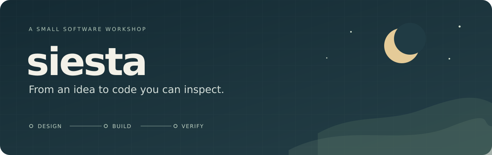
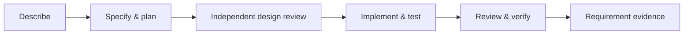

<p align="center">
  
</p>

<p align="center">
  <a href="https://github.com/jairorodriguezarias/siesta/actions/workflows/tests.yml"></a>
  <a href="docs/getting-started.md"></a>
  <a href="LICENSE"></a>
  
</p>

<p align="center">
  <a href="docs/getting-started.md">Get started</a> ·
  <a href="docs/architecture.md">How it works</a> ·
  <a href="docs/testing.md">Validation</a> ·
  <a href="CONTRIBUTING.md">Contribute</a>
</p>

Siesta turns a project idea into a specification, a reviewed plan and an
implementation with test evidence. It interviews you, runs coding agents,
recovers from blocked work and records what actually passed.

Built for small local applications. **Experimental:** inspect generated code
and the requirement report before relying on the result.

## Try a small project

Prefer windows to a terminal? Start the **[local desktop](docs/desktop.md)**:

```bash
PYTHONPATH=factory python -m pipeline.web
```

Open `http://127.0.0.1:8765` to launch projects, answer the interview and read
results. Play Snake while the agents work; the desktop alerts you when your
attention is needed. Use the Python environment from the setup guide below.

With Python, Git, [Pi](https://github.com/earendil-works/pi/tree/main/packages/coding-agent)
and your model access configured:

```bash
./factory/bin/siesta.sh 'Build a Python CLI timer with tests'
```

Already know exactly what you want? Skip the interview:

```bash
./factory/bin/siesta.sh --auto \
  'Build sum_cli.py: accept two integers, print their sum, reject invalid input. Use one issue with pytest tests.'
```

Follow the **[setup guide](docs/getting-started.md)** for installation and model
configuration. The committed defaults use **Ollama Cloud** through a local
Ollama daemon. [Local inference](docs/ollama-local.md) is a separate option.

## A small, explicit workflow



**Review before implementation.** Two fresh readers check clarity and readiness
using only the intent, specification and plan. A rejected design stops the run
with findings you can act on.

**Require execution evidence.** Python runs the tests and applicable smoke
checks. A separate reviewer maps each requirement to passing test IDs and
source files. Missing evidence or a contradiction prevents completion.

**Keep progress recoverable.** Each completed issue has a Git commit. Blocked
work is archived before cleanup. Relaunching the same idea resumes the project;
successful completed runs do not repeat model work.

**Extend an existing project.** Select it with `--project` and add a request
using `--iterate`. New requirements and issues are appended and pass through
design review, testing and requirement evidence. See
[safe repository iterations](docs/repository-iterations.md).

The orchestrator uses Python's standard library. Pi supplies model access and
coding tools; roles are selected explicitly in
[`models.json`](factory/config/models.json).

## Inspect the result

Projects live under `factory/projects/<project>/`:

| Artifact | What it tells you |
| --- | --- |
| `spec.md`, `issues.md` | What was requested and how work was divided |
| Source, tests and Git history | What was implemented and committed |
| `.siesta/design-review.md` | Why the design passed or was rejected |
| `.siesta/requirements.md` | Evidence and gaps for each acceptance criterion |
| `verify_verdict.txt` | The persisted verification result |
| `.siesta/calls.jsonl` | Model routing, call duration and exit status |
| `kb/graph.json` | Decisions, blockers and learning |

The evidence report combines **model judgment** with mechanically checked test
references. It is not a proof of complete coverage. Token usage and monetary
cost remain unknown when Pi's text output does not expose them.
Requirement evidence currently supports Python/pytest projects; other test
runners cannot establish this final gate yet.

## Development

```bash
python3 -m venv .venv
source .venv/bin/activate
python -m pip install -r requirements-dev.txt
cd factory
python -B -m unittest discover -s tests -v
```

The offline suite uses real Git and test subprocesses with a fake Pi. Live
evaluations exercise actual models and independently check generated CLI
behavior. See **[validation and recorded results](docs/testing.md)**.

## Documentation

- [Getting started](docs/getting-started.md) — install, configure, run and resume.
- [Desktop](docs/desktop.md) — local retro interface, project activity and Snake.
- [Repository iterations](docs/repository-iterations.md) — resume, extend and adopt local edits.
- [Architecture](docs/architecture.md) — roles, gates, recovery and learning.
- [Local Ollama](docs/ollama-local.md) — native tools and actual context windows.
- [Testing](docs/testing.md) — offline checks, live evaluations and limitations.
- [Agent contracts](AGENTS.md) — implementation rules and phase responsibilities.

## License and acknowledgments

[MIT](LICENSE). Workflows adapt
[Addy Osmani's agent-skills](https://github.com/addyosmani/agent-skills), with
notices preserved in [THIRD_PARTY_NOTICES.md](THIRD_PARTY_NOTICES.md).
The execution loop draws inspiration from
[Ralph](https://github.com/SantanderAI/ralph); independent design review takes
inspiration from [Elephant Goldfish Model](https://github.com/google/elephant-goldfish-model).
