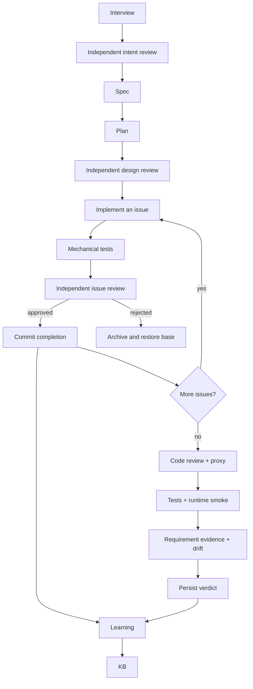

# Architecture

Siesta is a sequential Python pipeline around Pi. Python owns state, tests,
commits and the final verdict. Models produce documents, code or review
judgments within the tools explicitly enabled for each call.

## Context boundaries

The planner and worker receive relevant recorded context. Design reviewers
receive only the original intent, spec and plan. Evidence reviewers receive
acceptance criteria, selected source and passing test IDs. These calls disable
Pi sessions, context files and implicit extension/skill/template loading, with
tools disabled. They do not receive the authoring conversation or KB.

At interview closeout, the tool-free intent critic compares the original
request and explicit human answers with the candidate intent. It can correct
the candidate only with quotes from that evidence. An unresolved preference is
recorded as a blocker before specification; an interactive confirmation is
retained in the interview evidence.

Design review has three independent lenses: comprehension, simplicity and
implementation readiness. Python also requires every acceptance ID to map to
an issue with a test strategy and rejects forward, missing or self-dependencies.
Blocking findings can trigger up to two planner-proposed document repairs. Python
keeps acceptance criteria and completed issue bodies fixed, validates and
commits each repair, then reruns all three reviews. Approval is cached against
exact document contents, agent definitions and model routes.

Review is a model judgment. It can miss defects or raise a mistaken finding.
Only Python can declare the mechanical suite successful. Evidence review adds
a requirement-level check; it cannot override failed or absent tests.

## State and recovery

- `issues.md` defines work; committed KB completion nodes are its ledger.
- `.pipeline-checkpoint` records traversed phases. Pending issues invalidate
  downstream review and verification.
- `.git/siesta-state.json` binds review approval to the relevant inputs.
- `.siesta/` holds ignored design reports, test IDs, evidence and call metrics.
- `verify_verdict.txt` persists the verdict used by completion records.

An issue is complete only after passing tests and a successful commit. Known
blocked work is archived under `.git/siesta-recovery/` before restoration.
Unknown uncommitted work at resume is preserved. The source collector excludes
ignored files, private paths, dependencies, symlinks and local evidence.

Pi calls share one bounded subprocess path. Provider diagnostics drain to a
temporary file; stdout is accepted only after a successful process exit.
Timeouts preserve partial evidence and terminate the process group.

## Learning

Project and global KBs record observations and patterns. A project pins the
factory and adapted skill contents in ignored `.siesta/` evidence and verifies
those hashes on resume. The learner records complete factory skill candidates
as pending proposals with the previous version, candidate, reason and evidence;
it never activates them during that run. The adapted development skills remain
repository-maintained. Learning is recorded advice, not evidence that
performance improved.

## Source map

| Module | Owns |
| --- | --- |
| `pipeline/__main__.py` | Dispatch, resume, completion and failure records |
| `pipeline/phases.py` | Prompts, issue execution, recovery and mechanical checks |
| `pipeline/issue_reviews.py` | Independent issue review, bounded repairs and approval binding |
| `pipeline/intent_review.py` | Evidence-bound interview closeout and user-decision blockers |
| `pipeline/source_context.py` | Bounded source collection with explicit path exclusions |
| `pipeline/design.py` | Independent design and requirement evidence gates |
| `pipeline/pi.py` | Model invocation, deadlines and call metrics |
| `pipeline/repository.py` | Committed ledger, product identity and Git operations |
| `pipeline/files.py` | Source selection and local evidence directory |
| `pipeline/kb.py`, `pipeline/learn.py` | Memory and learning |
| `pipeline/evaluate.py` | Isolated live-model evaluation cases |
| `pipeline/skill_scenarios.py` | Strict YAML validation, simulated assertions and optional live skill evaluation |
