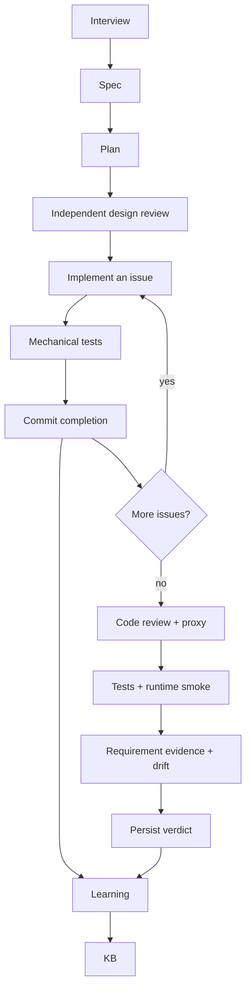

# Architecture

Siesta is a sequential Python pipeline around Pi. Python owns state, tests,
commits and the final verdict. Models produce documents, code or review
judgments within the tools explicitly enabled for each call.

## Context boundaries

The planner and worker receive relevant recorded context. Design reviewers
receive only the original intent, spec and plan. Evidence reviewers receive
acceptance criteria, selected source and passing test IDs. These calls disable
Pi sessions, context files and implicit extension/skill/template loading, with
tools disabled. They do not receive the authoring conversation or KB.

Design review has two lenses: comprehension and implementation readiness.
Either rejection stops implementation. Approval is cached against exact input
contents and model routing, so changed documents require another review.

Review is a model judgment. It can miss defects or raise a mistaken finding.
Only Python can declare the mechanical suite successful. Evidence review adds
a requirement-level check; it cannot override failed or absent tests.

## State and recovery

- `issues.md` defines work; committed KB completion nodes are its ledger.
- `.pipeline-checkpoint` records traversed phases. Pending issues invalidate
  downstream review and verification.
- `.git/siesta-state.json` binds review approval to the relevant inputs.
- `.siesta/` holds ignored design reports, test IDs, evidence and call metrics.
- `verify_verdict.txt` persists the verdict used by completion records.

An issue is complete only after passing tests and a successful commit. Known
blocked work is archived under `.git/siesta-recovery/` before restoration.
Unknown uncommitted work at resume is preserved. The source collector excludes
ignored files, private paths, dependencies, symlinks and local evidence.

Pi calls share one bounded subprocess path. Provider diagnostics drain to a
temporary file; stdout is accepted only after a successful process exit.
Timeouts preserve partial evidence and terminate the process group.

## Learning

Project and global KBs record decisions and patterns. The learner can update
the five factory skills when it returns a complete, valid skill document.
The ten adapted development skills require a repository change. Learning is
recorded advice, not evidence that performance improved.

## Source map

| Module | Owns |
| --- | --- |
| `pipeline/__main__.py` | Dispatch, resume, completion and failure records |
| `pipeline/phases.py` | Prompts, issue execution, recovery and mechanical checks |
| `pipeline/design.py` | Independent design and requirement evidence gates |
| `pipeline/pi.py` | Model invocation, deadlines and call metrics |
| `pipeline/repository.py` | Committed ledger, product identity and Git operations |
| `pipeline/files.py` | Source selection and local evidence directory |
| `pipeline/kb.py`, `pipeline/learn.py` | Memory and learning |
| `pipeline/evaluate.py` | Isolated live-model evaluation cases |
