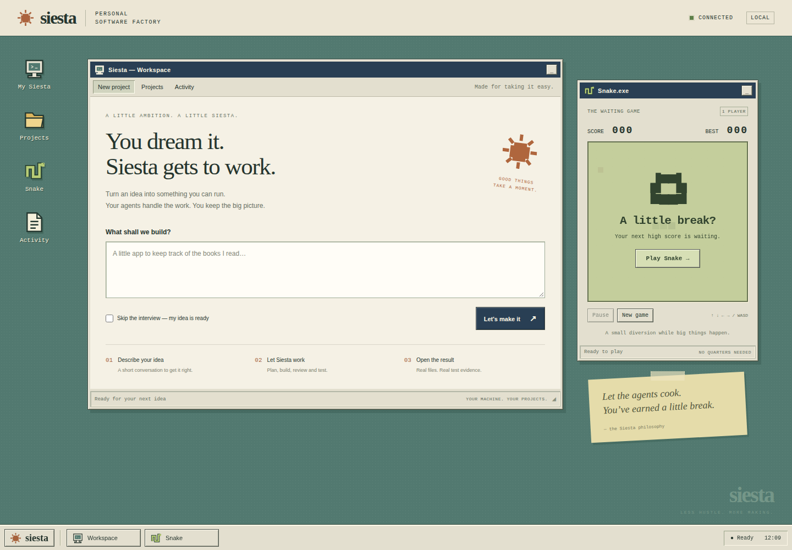

# The Siesta desktop

A local 1990s-style desktop for starting projects, answering the interview,
following execution and reading requirement evidence. Snake runs in its own
window while the pipeline works.



## Start

Use the Python environment from the [setup guide](getting-started.md), including
pytest, and run from the repository root:

```bash
PYTHONPATH=factory python -m pipeline.web
```

Open **http://127.0.0.1:8765**. Keep the server terminal open. Change the port
with `--port 8766`; select another factory using `--factory /path/to/factory`
or `SIESTA_FACTORY`. Model configuration and Pi/Ollama prerequisites are the
same as for the CLI. Opening the desktop or playing Snake makes no model calls.

The browser interface needs no Node installation, frontend build, CDN or new Python
dependency. It uses the same Unix process-group support as the pipeline and
an advisory factory lock; Windows without WSL is not supported.

## Work and play

- **New project:** give the project a visible name, describe your idea and start. The interview runs unless you
  explicitly select “Skip the interview”. Starting a project calls the configured
  models, just like the CLI.
- **Activity:** inspect the current phase, elapsed time and recent console
  output. When Siesta asks a question, write your answer below the console.
  For the interview's final summary, type `yes` or explain what should change.
  Stop ends the active process and leaves its current evidence for recovery.
- **Projects:** inspect saved projects, specifications, issue plans, design
  reviews and requirement evidence. Resume preserves the selected directory and
  its saved model routes, including imported projects. Canonical projects can
  resume an unfinished interview by their original idea; imported projects use
  the CLI's committed-project validation.
  A completed project uses the pipeline's existing recheck/resume behavior.
  Edit changes its visible name without moving its Git directory. Delete moves
  it to `factory/projects/.trash/` after confirmation; it disappears from the
  Projects list and can be restored manually from that directory.
- **Knowledge:** browse global and project KB entries, search titles, types or
  details, open node text and follow linked KB relations. Add a global reference note before starting
  a project. New projects copy the current notes into their own KB; later edits
  to global notes do not change an existing project's context. Notes support
  the specification and worker prompts but do not override the approved intent.
- **Snake:** press Play, then use arrows or WASD. Space pauses/resumes; New game
  restarts. Touch direction controls appear on narrow screens. The game pauses
  when the tab loses visibility, the browser loses focus, another window's
  control receives focus, or Snake is minimized. The best score is stored in
  this browser when local storage is available.
- **Notices:** interview requests and terminal results appear above the taskbar,
  even when the workspace is minimized. They do not steal the game's keyboard
  focus. “View activity” takes you back to the work and focuses a pending reply.

Reloading or closing the browser does not restart or stop the run. Reopening
the desktop reconnects to the server's current process. Ctrl+C in the server
terminal stops the server and unwinds its active pipeline/Pi subprocesses.
An interrupted project can contain unfinished work; the normal CLI recovery
rules apply when you resume. Existing project files are not deleted.

## State and limits

The service binds to loopback only. Host/Origin checks and a per-server request
token protect mutations from other websites. The service is for one trusted
local operator, not remote hosting or multiple accounts.

One desktop owns a factory at a time, and only one run may be active. Do not
start a separate CLI run against that factory while the desktop is working:
the global KB does not support concurrent writers. Role defaults live in
`factory/config/models.json`; phase and agent model routes can be selected on
New project and changed when resuming a project. The browser displays the Pi
and Ollama catalog without credentials and shows when a model needs setup.
Before starting, choose normal or deep review. The policy is pinned to the
project on resume. The activity window shows the current agent and model,
review round, blocking findings and calls/active minutes used. Token and cost
values display as unknown until a provider supplies reliable totals.
Project names are local metadata; the Git directory key still derives from the
original idea. CLI runs may set a name with `--name`, while older projects
display their existing directory key until renamed. Editing or
deleting a project is unavailable during an active run.

“Complete” requires a successful process exit, the `complete` checkpoint and
`VERIFY_PASSED`. Failed, stopped and unverified runs remain distinct. A green
desktop result is the pipeline's verdict; inspect generated code and evidence.

The console shows the last 64 KiB; each document view shows the first 64 KiB.
The project list is capped at 200 directories in name order. Documents are
plain text and restricted to the displayed evidence files. Raw source editing,
arbitrary filesystem browsing and deleting projects are outside this UI.
The Knowledge view lists 100 entries per page. Global references are limited
to 50 notes, each with a 160-character title and 12000-character body; model
prompts include at most 12000 characters of reference context and identify
truncation. Notes cannot be changed during an active run.

Live console/status records are temporary and belong to the running server.
Restarting the server clears its live view, while project files, checkpoints,
and `.siesta/` evidence remain available through Projects. There are no remote
browser notifications or background push service.

## Verification

Backend tests exercise real local HTTP and child processes, including stale
interview replies, duplicate launches, process failures, completion verdicts,
file traversal/symlinks, factory locks and cleanup of a separate Pi process
group. Run these with the existing Python suite:

```bash
cd factory
python -B -m unittest tests.test_web tests.test_web_runner -v
python -B -m unittest discover -s tests -v
```

Snake's pure rules use Node's built-in test runner (development only):

```bash
node --test factory/tests/test_snake.mjs
```

The optional browser check uses a temporary factory and a controlled child,
without contacting any model. From the repository root:

```bash
npm install --prefix .runtime/browser-check --no-audit --no-fund playwright
.runtime/browser-check/node_modules/.bin/playwright install chromium
node factory/tests/web_smoke.mjs
```

Set `PYTHON` to a Python executable if needed. An existing Playwright install
can be selected with `SIESTA_PLAYWRIGHT_MODULE` pointing to its `index.mjs`.
The check covers interview input, reconnect after reload, completed-project
resume, notices, plain-text evidence, Snake controls and desktop/mobile layout,
and rejects browser errors.
Screenshots are written to `.runtime/desktop-check/`.

These checks verify the web adapter and interaction. They do not establish
live-model reliability; see the separate [model evaluations](testing.md).
